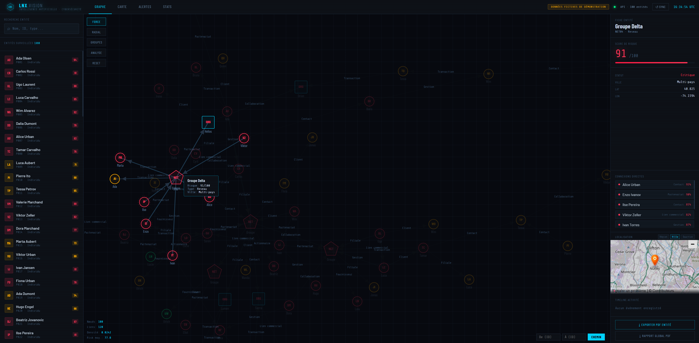
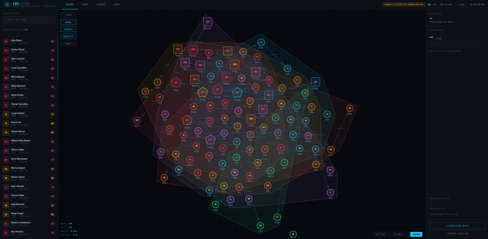
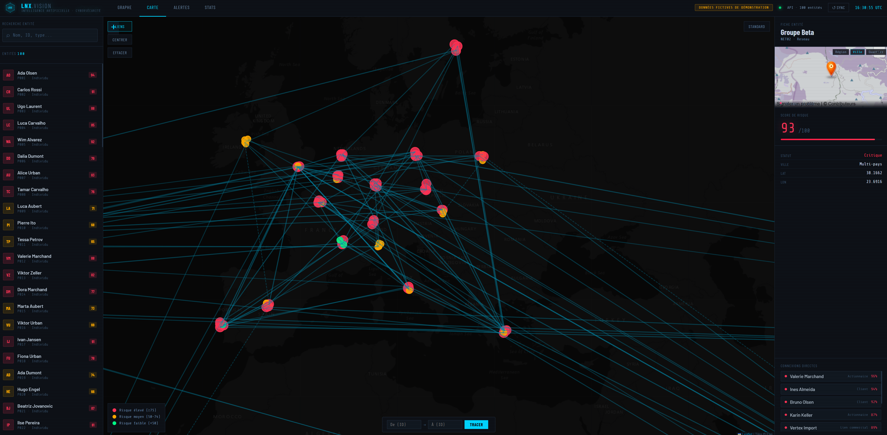
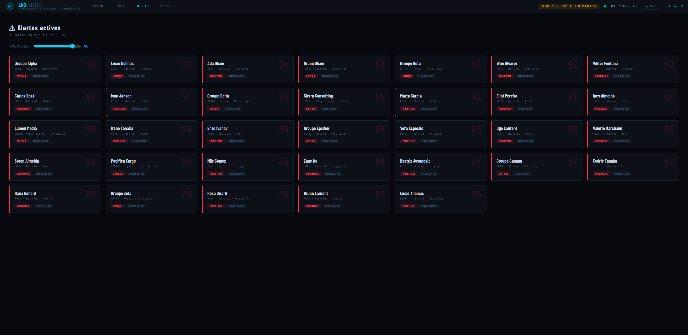
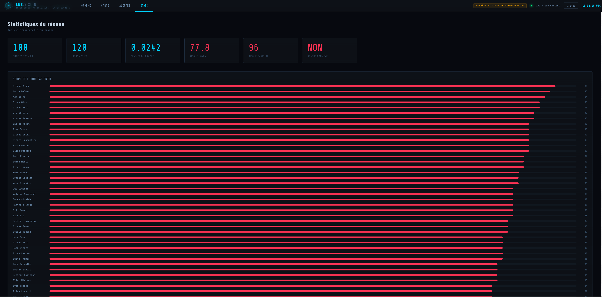
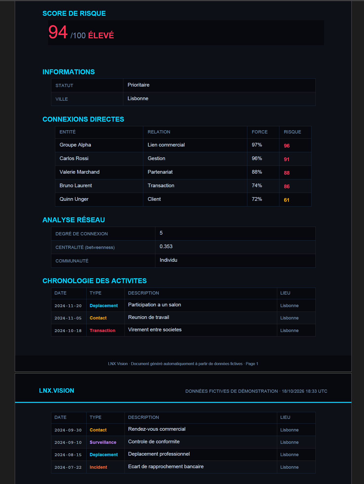
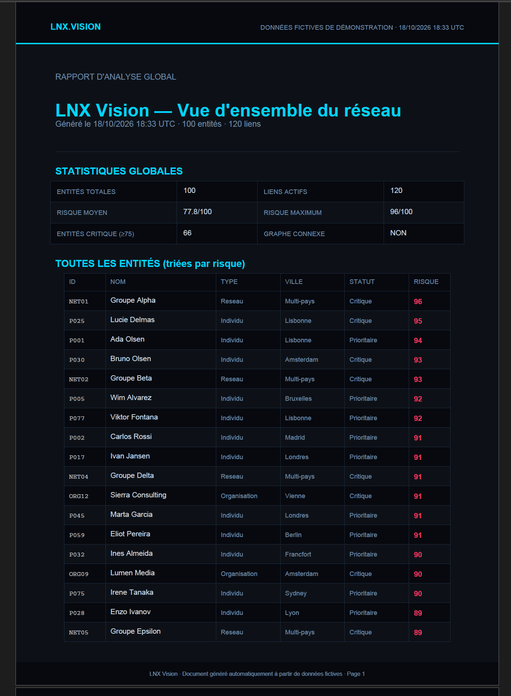

[English](README.md) | [Français](README.fr.md)

# LNX Vision

Entity network analysis platform: a FastAPI backend builds a graph from tabular data, and a web interface (HTML) lets you explore it (graph, map, alerts, statistics) and export PDF reports.

## Features

- Interactive graph of entities and their relationships (force, radial, groups and analysis views)
- Entity search, detail panel, risk score, direct connections
- Path finding between two entities
- Map, alerts and statistics
- PDF export for a single entity and a global report

## Screenshots

Demo data only (fictitious).

**Interactive graph with entity detail panel**



**Group and community analysis view**



**Map of entities and links**



**Alerts above a risk threshold**



**Network statistics**



**PDF report for one entity**



**Global PDF report**



## Notice on the data

The entities, names, relationships, risk scores and alerts in `app/data/entities.xlsx` are **entirely fictitious**: invented names, generic cities and events, randomly assigned relationships. This demo dataset was generated with the help of Claude (Anthropic) to test the application. Any resemblance to real people, organizations or events would be coincidental, and this data must not be interpreted as information about real persons.

The ICIJ data (Offshore Leaks), on the other hand, is real and subject to the ICIJ's terms of use (see below). It is not included in this repository.

## Notice on the use of real data

Risk scores and statuses ("Critique", "Prioritaire", "Suivi", "Analyse", "Veille" in the demo dataset; "Critique", "Surveillance", "Enquete", "Interet" in the ICIJ conversion) are **structural** indicators: for ICIJ data, they are based solely on the number of connections an entity has in the graph. They are not an assessment of dangerousness, an accusation, or evidence of wrongdoing.

When applied to real data (for example ICIJ data converted with `icij_to_nexus.py`), they must not be used to single out, accuse or profile people or organizations. The ICIJ reminds users that appearing in its databases does not imply any wrongdoing.

The user is solely responsible for how they use the tool and for the data they load into it, in compliance with applicable law (GDPR, defamation, terms of use of data sources). The author disclaims all liability in this respect.

## Project structure

```
LNX_Vision_V1/
├── app/
│   ├── main.py            # FastAPI entry point (routes under /api)
│   ├── api/routes.py      # API routes
│   ├── core/              # Graph building, analysis, PDF reports
│   └── data/entities.xlsx # Entity data (fictitious)
├── frontend/              # Python frontend application
├── lnx_vision.html        # Main interface
├── lnx_intel.html         # Complementary interface
├── icij_to_nexus.py       # ICIJ data conversion
├── add_coordinates.py     # Adds approximate coordinates (by country) for the map
├── launch_lnx.bat         # Quick launcher for Windows
├── LANCEMENT.txt          # Launch notes (French)
└── requirements.txt       # Python dependencies
```

## Requirements

- Python 3.10
- Windows (`launch_lnx.bat` targets Windows; the rest works elsewhere)

## Installation

```powershell
git clone https://github.com/alexandre196/LNX_VISION.git
cd LNX_VISION
python -m venv venv
venv\Scripts\activate
pip install -r requirements.txt
```

## ICIJ data

The `icij/` folder is not versioned (files too large). To use it:

1. Download the Offshore Leaks dataset from the ICIJ website, respecting its terms of use and license (attribution to the ICIJ). Appearing in this database does not imply any wrongdoing by a person or company.
2. Place the CSV files (`nodes-*.csv`, `relationships.csv`) in an `icij/` folder at the project root.

## Running

1. Start the API with the virtual environment activated:

```powershell
uvicorn app.main:app --reload
```

The API is available at `http://127.0.0.1:8000` and its interactive documentation at `http://127.0.0.1:8000/docs`.

2. Open `lnx_vision.html` in a browser (double-click the file). The API must stay running in its own terminal while you use the interface.

The **CARTE** (map) tab requires an Internet connection to load the base map (Esri dark tiles).

## Troubleshooting

- **"Impossible de joindre l'API / Failed to fetch"**: the API is not running (restart `uvicorn app.main:app --reload` in a dedicated terminal and leave it open), or a route returns an error (check the uvicorn terminal).
- **The map background is gray or shows an error**: check your Internet connection. The base map is loaded from Esri servers; some tile providers (OpenStreetMap, CARTO) refuse pages opened from a local file or require a key.
- **A dependency is missing (`openpyxl`, `reportlab`...)**: activate the venv, then run `pip install -r requirements.txt`.
- **`ModuleNotFoundError`**: the virtual environment is not activated or dependencies are not installed (`pip install -r requirements.txt`).
- **A copied or moved venv no longer works**: delete it and recreate it at its current location.

## License

© 2026 Alexandre Martin. All rights reserved.

This code may not be copied, modified, redistributed or used for commercial purposes without the author's written permission. It is provided as is, without warranty of any kind.
